<picture>
  <source media="(prefers-color-scheme: dark)" srcset="./assets/header-dark.svg">
  
</picture>

<picture>
  <source media="(prefers-color-scheme: dark)" srcset="./assets/numbers-dark.svg">
  
</picture>

<picture>
  <source media="(prefers-color-scheme: dark)" srcset="./assets/expertise-dark.svg">
  
</picture>

&nbsp;<b>01</b>&nbsp;&nbsp; Urban heat and thermal comfort

 

How hot a street feels to the person standing in it, and how that is changing. I compare heat stress indices, model radiant heat from sun and surfaces, and test cooling measures such as trees and shade in microclimate simulations.

&nbsp;<b>02</b>&nbsp;&nbsp; Earth observation and downscaling

 

Climate reanalysis comes in pixels about 9 km wide. I bring it down to 10 m with satellite imagery, building heights, tree canopy and machine learning, so the map shows single streets and squares. Air pollution from Sentinel-5P gets the same treatment at 100 m.

&nbsp;<b>03</b>&nbsp;&nbsp; Climate data analysis

 

Long hourly records turned into plain answers: how fast a city warms, how many extra hot days arrive, and how sure we can be about it. Python pipelines, cloud processing in Earth Engine and regional climate runs on HPC.

&nbsp;<b>04</b>&nbsp;&nbsp; Field sensing and perception

 

People walk the city wearing sensors, then rate how warm, how clean and how quiet it feels. Matching the two shows where measured conditions and lived experience part ways.

&nbsp;<b>05</b>&nbsp;&nbsp; CityAI

 

The studio I founded for city data tools and GIS training: open boundary datasets, hands-on QGIS workshops and web platforms built for researchers.

 

<!-- LATEST:START -->
<picture>
  <source media="(prefers-color-scheme: dark)" srcset="./assets/latest-dark.svg">
  
</picture>

<a href="https://github.com/exploringravi/Cyprus-Weather-Data">Cyprus Weather Data</a> &nbsp;·&nbsp; <a href="https://github.com/exploringravi/Statistical-downscaling-of-UTCI">Statistical downscaling of UTCI</a> &nbsp;·&nbsp; <a href="https://github.com/exploringravi/India_admin_boundaries">India admin boundaries</a> &nbsp;·&nbsp; <a href="https://github.com/exploringravi/threshold-proximity-utci">threshold proximity utci</a> &nbsp;·&nbsp; <a href="https://github.com/exploringravi/letshike">letshike</a>

<!-- LATEST:END -->

 

<picture>
  <source media="(prefers-color-scheme: dark)" srcset="./assets/path-dark.svg">
  
</picture>

 

<a href="https://orcid.org/0000-0003-1195-2464">ORCID</a> &nbsp;&nbsp; <a href="https://www.linkedin.com/in/ravi-pandey-68956b120/">LINKEDIN</a>

